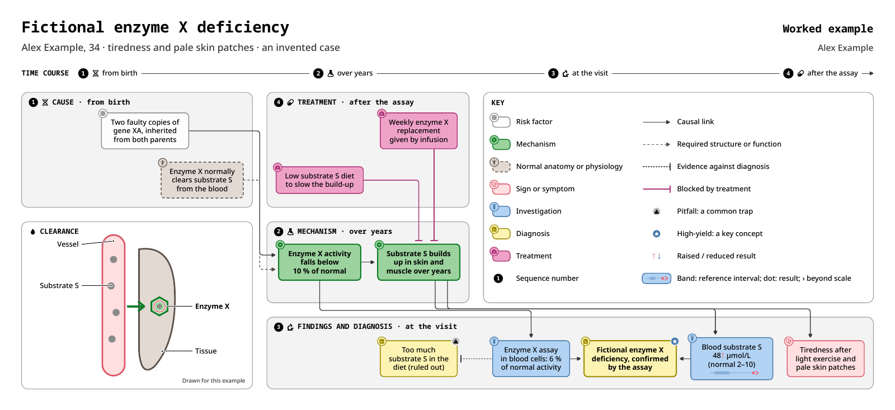
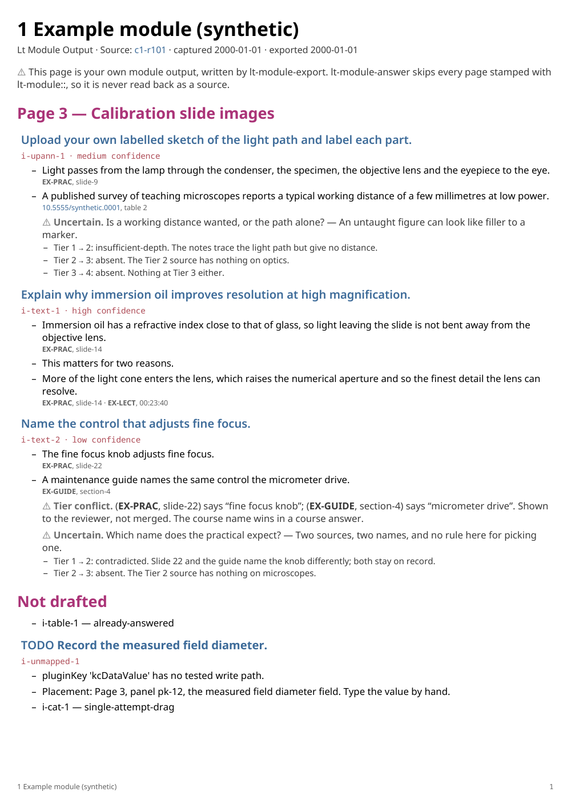
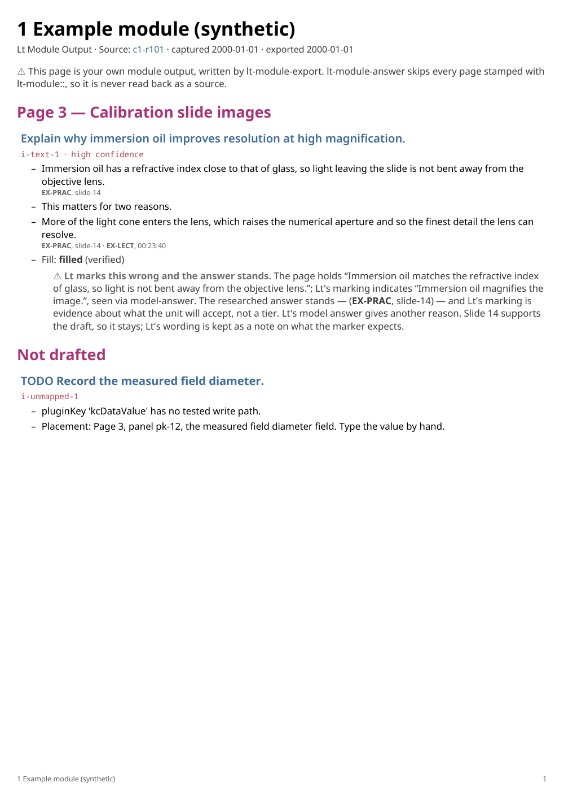
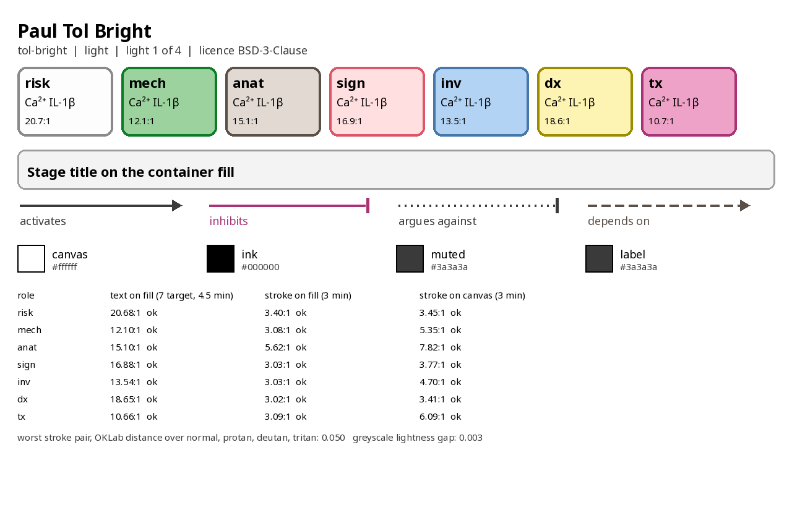
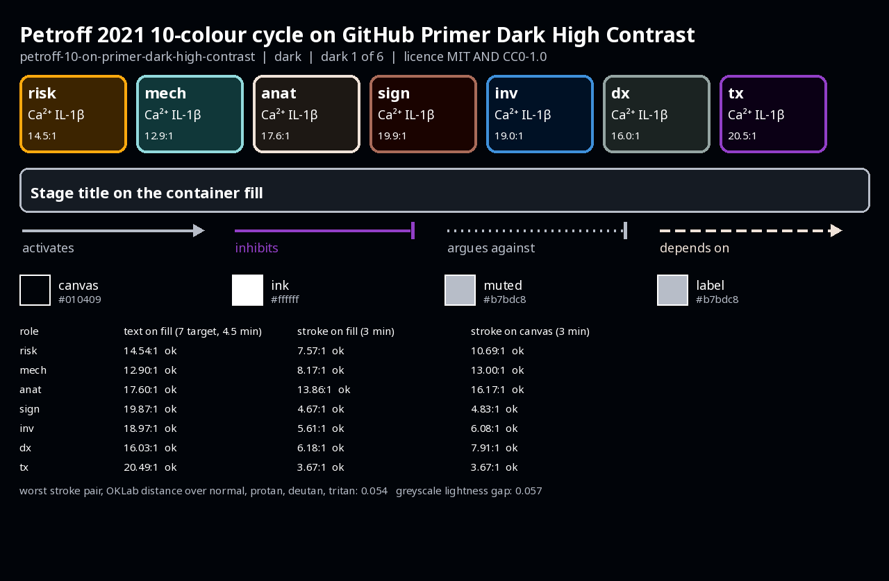
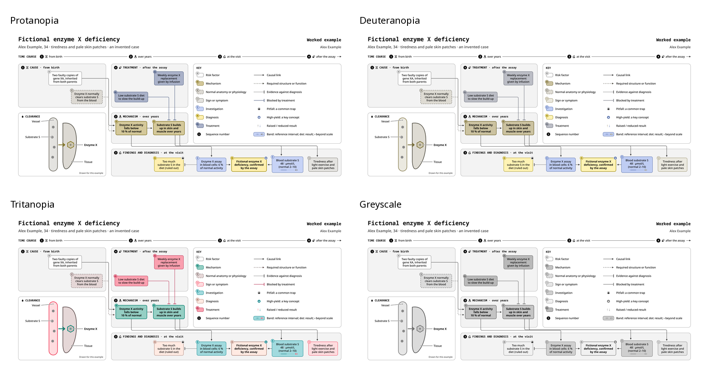

<!-- SPDX-FileCopyrightText: 2026 dorsaltegmentum -->
<!-- SPDX-License-Identifier: AGPL-3.0-or-later -->

# lt-suite

lt-suite captures Lt modules, drafts sourced answers, fills drafts for review, and exports notes, PDFs and diagrams.
**lt-suite never submits. You review and submit in Lt.**

lt-suite is unofficial and unaffiliated with ADInstruments, Lt and kuraCloud.

<picture>
  <source media="(prefers-color-scheme: dark)" srcset="docs/assets/toy-diagram-dark.png">
  
</picture>

Synthetic example. A mechanism diagram built from the toy case in `skills/mechanistic-diagram/examples/toy-case`, an invented enzyme deficiency. Palette: Paul Tol Bright (dark mode shows Petroff 2021 10-colour cycle on GitHub Primer Dark High Contrast). [One-page PDF](docs/assets/toy-diagram-print.pdf), [build checks](docs/assets/diagram-build.txt).


## The 6 skills

| Skill | Result |
|---|---|
| `lt-suite-setup` | First-time setup, dependency checks and past-run review |
| `lt-module-capture` | Read-only capture into `module.json`, with submitted work quarantined |
| `lt-module-answer` | Draft `answers.json` with source tags for factual claims |
| `lt-module-fill` | Enter reviewed drafts, verify saves and produce a fill report |
| `lt-module-export` | Markdown and PDF exports, with optional notes and study handoffs |
| `mechanistic-diagram` | Editable draw.io diagrams, SVG, PDF, PNG and interactive HTML |

Start with setup, then capture, draft, review, fill, review and export.
The diagram skill also works on supplied material without a live Lt module.



Synthetic example. A module export built from the schema example in `tests/fixtures/examples`. Every claim carries a source tag. [Full PDF](docs/assets/sample-module-export.pdf).



Synthetic example. The same module after a fill run that stopped before a one-way door. The suite never clicks Submit: the human reads this page, then submits. [Full PDF](docs/assets/sample-fill-review.pdf), [export log](docs/assets/export-run.txt).


## First run

Every local route ends with **"Set up lt-suite"**.
The `lt-suite-setup` skill asks for institution, paths, browser, palette and fonts.
It installs Python dependencies in an external environment and runs `doctor`.

Use Python 3.11+ and Node.js 22.20+ for the documented installer routes.
For `lt-chrome`, enable remote debugging at `chrome://inspect/#remote-debugging` in Chrome 144+.
Sign in to Lt yourself, then approve the browser connection.
The suite uses your existing tab.

### Claude Code

```sh
claude plugin marketplace add dorsaltegmentum/lt-suite
claude plugin install lt-suite@lt-suite
# Restart Claude Code and ask: "Set up lt-suite".
# Use lt-chrome, or Claude in Chrome when available.
```

Claude Code 2.1.306 passed local validation, plugin loading and discovery of all 6 skills.

### Codex CLI

```sh
codex plugin marketplace add dorsaltegmentum/lt-suite
codex plugin add lt-suite@lt-suite
# Merge examples/mcp/codex-config.toml into your Codex config.
# Restart Codex and ask: "Set up lt-suite".
```

Codex CLI 0.162.1 discovered all 6 skills through plugins, project skills and user skills.
The MCP example restricts tools and keeps action approval enabled.

### Gemini CLI

```sh
gemini extensions install https://github.com/dorsaltegmentum/lt-suite
# Enable the extension's lt-chrome server.
# Ask: "Set up lt-suite".
```

The extension targets local capture, drafting, fill and export.
Gemini CLI installation and browser execution still need a manual check.

### Antigravity

```sh
agy plugin install https://github.com/dorsaltegmentum/lt-suite
# Use lt-chrome with your signed-in browser.
# Ask: "Set up lt-suite".
```

Antigravity installation and its stdio browser connection still need a manual check.
Its built-in browser uses a separate profile.

### GitHub Copilot CLI and VS Code

```sh
copilot plugin install dorsaltegmentum/lt-suite
# VS Code: Chat: Install Plugin From Source > repository URL.
# Check lt-chrome, then ask: "Set up lt-suite".
```

Copilot targets the local workflow; this release has no completed Copilot runtime check.

### Cursor

```sh
npx skills add dorsaltegmentum/lt-suite -a cursor
# Add examples/mcp/cursor-mcp.json to your Cursor MCP config.
# Ask: "Set up lt-suite".
```

Cursor needs the separate browser server for live Lt work.
The installer route and Cursor runtime have separate verification steps.

### Other agents through npx skills

```sh
npx skills add dorsaltegmentum/lt-suite
# Choose your agent; the installer adds skills.
# Add a browser adapter from examples/mcp/, or use manual paste.
# Ask: "Set up lt-suite".
```

Manual paste lets you run each rendered script in your Lt tab's DevTools console.
Return its JSON receipt to the agent.

### claude.ai and Claude Desktop chat

```text
1. Download per-skill archives from the latest release's claude-ai folder.
2. Enable code execution and upload the archives through Claude's Skills settings.
3. Ask: "Set up lt-suite"; save the printed config for later sessions.
```

Hosted Claude supports supplied-file drafting, export and diagram preparation.
Live capture and fill require a local installation.
ZIP checks verify files and entry points; hosted upload acceptance still needs a manual check.

### ChatGPT

```text
1. Check whether your workspace accepts external skills or plugins.
2. The release builds lt-suite-plugin-<version>.zip for supported plugin distribution.
3. Where accepted, use uploaded files for drafting and diagram preparation.
```

ChatGPT has no verified end-user ZIP install route for this release.
Plan eligibility and workspace controls need a manual check.
This release provides no ChatGPT browser capture or fill.

Detailed steps: [platform installation guides](docs/install/).

## What works where

| Surface | Intended workflow | Installation evidence |
|---|---|---|
| Claude Code | Local capture, draft, fill, export, diagrams | 2.1.306: validation and 6-skill discovery passed |
| Codex CLI | Local workflow through lt-chrome | 0.162.1: all 3 discovery routes passed |
| Gemini CLI, Antigravity | Local workflow through lt-chrome | Static checks; runtime steps remain manual |
| Copilot CLI, local VS Code, Cursor | Local workflow with browser setup | Host runtime checks remain manual |
| npx skills | Skill folders for a selected local agent | Registry lookup skipped here after EAI_AGAIN |
| claude.ai, Claude Desktop chat | Supplied-file drafts, exports and diagrams | Isolated ZIP checks; upload remains manual |
| ChatGPT | Supplied-file drafts and diagrams where accepted | Workspace acceptance remains unverified |

Installation checks do not prove a live Lt workflow.
Hosted containers may lack PDF and PNG rendering binaries.
See [platform limits](docs/platforms.md) and [install checks](tools/install_tests/README.md).

## Save speed and review

Fill waits end when Lt acknowledges a save, with a capped fallback wait.
The first page calibrates each Lt origin automatically after fresh-load verification.
A verified 2-page batch then enables calls of up to **5 pages**.
A missing or unconfirmed item returns that origin to 1 page per call.
See [save waits and batching](docs/speed.md) for the calibration rules.

Fill maps Checkpoints and single-attempt items before writing.
Single-attempt writes need your recorded approval.
The suite stops at commit boundaries and gives you a review report.
Page guards and filtered browser tools support these rules.
The agent must follow them where browser guards cannot intercept an action.
See [safety](docs/safety.md).

## Palettes and fonts

The measured defaults are **Tol Bright** for light and print, and
**Petroff-10 on Primer Dark High Contrast** for dark.
The bundled fonts are **Noto Sans** and **Noto Sans Mono**.
Setup offers **Atkinson Hyperlegible Next** and its mono companion for low vision.

Ranking measures the derived diagram theme's text contrast, stroke contrast,
colour separation under 3 colour-vision simulations, and greyscale separation.
Setup shows previews before you choose your palettes and fonts.
See [measurements and font licences](docs/fonts-and-palettes.md).



Synthetic example. The setup skill's preview of the default light palette, Paul Tol Bright, with measured contrast.



Synthetic example. The dark default uses Petroff-10 on Primer Dark High Contrast.



Synthetic example. The toy diagram as seen with three kinds of colour-vision deficiency and in greyscale. Every box keeps its text label and every arrow keeps its dash or head.


## Configuration and dependencies

Setup writes one TOML config and reports its location.
Use `--config <path>` or `LT_SUITE_CONFIG` to select it explicitly.
Sandboxed agents can use `./lt-suite.toml` with external Python environments.
`LT_SUITE_DATA` selects the data folder.

| Setting | Default | Purpose |
|---|---|---|
| `lt.origin` | Empty | Your Lt origin; live browser work needs it |
| `model_answer.read` | `true` | Read and cite Lt's model-answer evidence |
| `fill.approval_mode` | `"manual"` | Require manual browser action approval |
| `fill.max_pages_per_call` | `5` | Upper limit after verified cross-page calibration |
| `notes.graph_path` | Empty | Optional notes destination |

Every key: [configuration](docs/configuration.md).
Start from [minimal config](examples/configs/minimal.toml), or an [institution example](examples/).
For renders, setup checks librsvg, Poppler and libxml2 programs.
See [Python setup](docs/install/python.md) and [troubleshooting](docs/troubleshooting.md).

## Academic integrity

Follow your institution's rules on AI assistance before using lt-suite.
Graded or invigilated work may forbid these workflows.
**The suite never submits; you review and submit.**
Check each draft and source yourself.
Set `model_answer.read = false` when model-answer reading is inappropriate for your work.
See [academic integrity](docs/academic-integrity.md).

Capture only modules you name; the suite forbids bulk harvesting.
Sign in yourself and keep credentials out of files and logs.
Keep course material and answers out of public issues.
Lt content retains its own terms and rights; this code's licence grants no rights to that content.
Your model provider receives material you give its agent.

## Contributing and licence

Use synthetic fixtures and follow [CONTRIBUTING.md](CONTRIBUTING.md).
Later contributor pull requests require DCO sign-off.
Report vulnerabilities through [private security reporting](SECURITY.md).
Agent rules: [AGENTS.md](AGENTS.md).

lt-suite is **AGPL-3.0-or-later**, copyright 2026 dorsaltegmentum.
See [LICENSE](LICENSE) and [third-party notices](THIRD_PARTY_NOTICES.md).
Bundled fonts and palette data retain their listed licences.

lt-suite is an independent, unofficial project.
It is not affiliated with, endorsed by or sponsored by ADInstruments, Lt or kuraCloud.
Lt and kuraCloud names belong to their respective owners.
