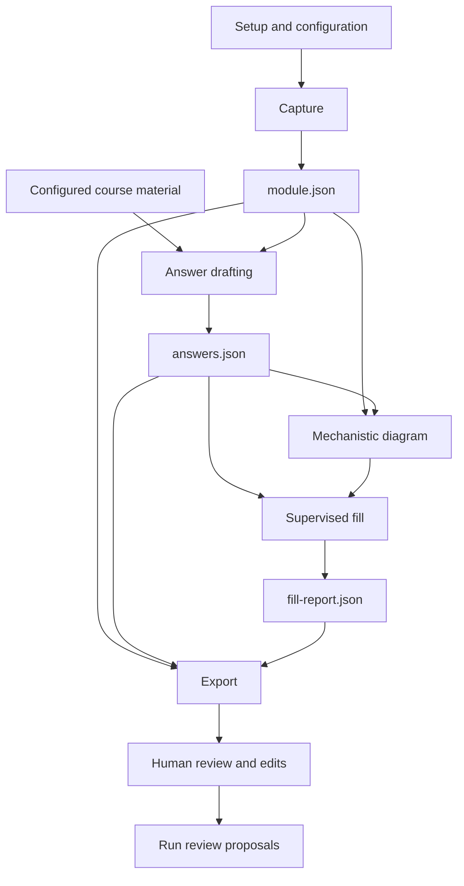

<!-- SPDX-FileCopyrightText: 2026 dorsaltegmentum -->
<!-- SPDX-License-Identifier: AGPL-3.0-or-later -->
<!-- Runtime components, handoffs and persistent state. -->

# Architecture

lt-suite connects six skills through validated files and a shared configuration.

| Skill | Main responsibility |
|---|---|
| `lt-suite-setup` | Configure dependencies, storage, browser, fonts and palettes; review past runs |
| `lt-module-capture` | Read a named module without writing |
| `lt-module-answer` | Draft answers with claim-level provenance |
| `lt-module-fill` | Enter reviewed drafts, verify persistence and stop before submission |
| `lt-module-export` | Produce Markdown, PDFs and optional study handoffs |
| `mechanistic-diagram` | Build editable and rendered mechanism diagrams |

## Data flow

An evaluation reference follows a separate path to the grader. Drafting does not load it.

## Contracts

The six handoff schemas describe `module`, `answers`, `reference`, `run`, `fill-report` and `approvals`. A separate configuration schema validates TOML settings after loading.

JSON Schema checks structure. Semantic rails check relationships such as question identity, provenance resolution, boundary exclusions and approval matching.

The old diagram interchange schema is absent. Diagram cases use the engine's case-folder format.

See [handoff contracts](../shared/schemas/README.md).

## Question identity

`answers.json` records the source capture's file hash and question digest.

The file hash identifies the exact capture. The question digest identifies its question-bearing content.

A changed question digest invalidates a draft. A changed capture hash with matching questions can represent a state-only recapture.

The digest excludes media and image geometry. A changed stimulus figure can therefore preserve the digest; review whole-file hash changes before accepting a recapture.

See [question digest](design-notes.md#question-digest).

## State split

Source code, generic lexicon entries and synthetic fixtures belong in the repository.

Captures, approvals, receipts, calibration and proposed personal corrections belong in the configured data directory.

| Data directory entry | Purpose |
|---|---|
| `captures/` | Validated captures, separate references and media |
| `incoming/` | Incoming capture files awaiting validation |
| `runs/` | Run records, approvals, generated scripts and receipts |
| `state/` | Calibration and operational ledgers |
| `lexicon/` | Proposed user overlay entries |
| `fonts/` | Fonts fetched during setup |

The configuration can change capture and run subdirectories.

## Shared runtime

`shared/ltcore/` holds configuration, paths, validation, browser rendering, approvals, styling and other reusable helpers.

`tools/sync_shared.py` computes each skill's Python import closure and declared data requirements. It writes generated copies inside that skill.

The generated copies support single-folder installation. Maintain source files under `shared/`; regenerate their copies.

Fill waits for save acknowledgements and verifies persistence from a fresh load. Per-origin calibration starts with one page, tests a two-page batch, then enables up to five pages per call. See [speed and calibration](speed.md) for exact signals, fallback rules and measurement limits.

## Improvement loop

Run review compares a draft with human edits and preserves the differences.

At least two runs must corroborate a recurring correction before the review proposes a shared change. Proposals stay in the data directory and require human approval.

The improvement loop does not edit shipped skills automatically. Evaluate accepted changes against the same benchmark before and after.

## Degraded delivery

When a write path or rendering tool is unavailable, preserve a prepared file and precise placement instructions.

A blocked item remains visible in the report. Missing capability never justifies guessing a selector, inventing an answer or crossing a boundary.
